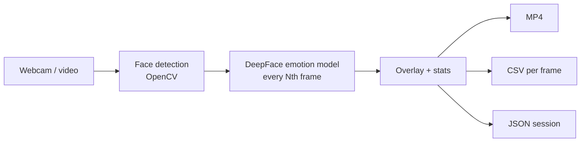

<h1 align="center">😊 Real-time Emotion Analyzer</h1>

<p align="center">Webcam or video in → faces tracked → 7 emotions scored live → annotated video, CSV and JSON out.</p>

<p align="center">
  
  
  
</p>

> **Docs only.** This repo has no source files yet: `realtime_emotion_analyzer.py`,
> `advanced_emotion_analyzer.py`, `config.json` and `requirements.txt` aren't committed.
> [Details →](#status--known-issues)

## Features

| | |
|---|---|
| 🎭 **7 emotions** | Happy, sad, angry, surprise, fear, neutral, disgust, each with a confidence % |
| 👥 **Multi-face** | Bounding boxes with smoothed tracking (no flicker) |
| 💾 **Outputs** | Annotated MP4, timestamped CSV, JSON session stats |
| ⚙️ **Config** | `config.json`: frame skip, camera, resolution, which outputs to save |
| ⌨️ **Controls** | `q` quit and save · `s` stats · `r` reset session |

## How it works



## Planned usage

```bash
pip install opencv-python deepface tensorflow numpy pandas
python realtime_emotion_analyzer.py      # basic
python advanced_emotion_analyzer.py      # recording + CSV/JSON export
```

Outputs go to `emotion_analyzer_output/{videos,data}/`.

| Setup | FPS | Latency |
|---|---|---|
| CPU (i7) | 10–15 | ~100 ms |
| GPU (RTX 3080) | 30–60 | ~30 ms |

## Status & known issues

| Issue | Effect |
|---|---|
| No code in the repo | Nothing to run yet; the commands above are the intended interface |
| Clone URL in the old docs was a placeholder (`yourusername`) | Removed |
| ~75 % accuracy (DeepFace's pretrained model) | Struggles with fear vs surprise, poor lighting and side faces |
| CPU-only inference | Low FPS unless frames are skipped |
| MIT badge but no `LICENSE` file | Licence isn't actually granted |

## Roadmap

- [ ] Commit the two scripts, `config.json`, `requirements.txt` and a `LICENSE`
- [ ] Sample output video and CSV in the README
- [ ] Fine-tune on FER-2013 / AffectNet; ONNX export for faster CPU inference
